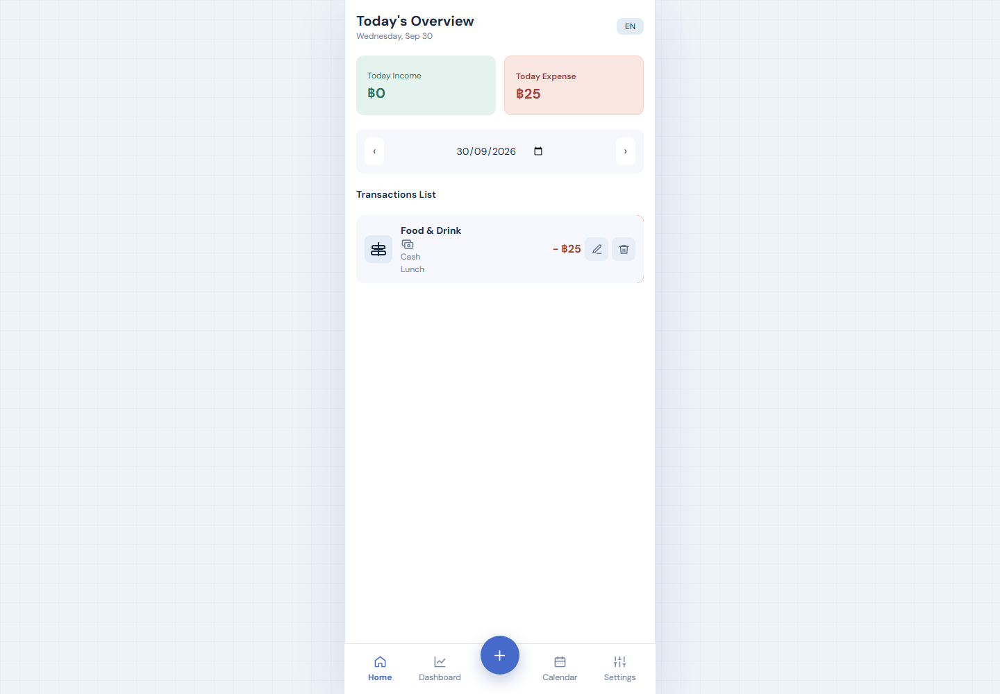
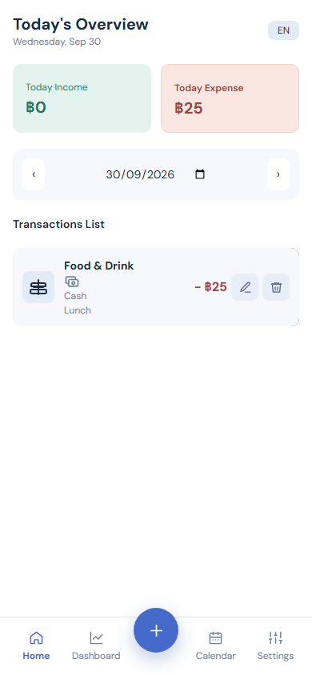
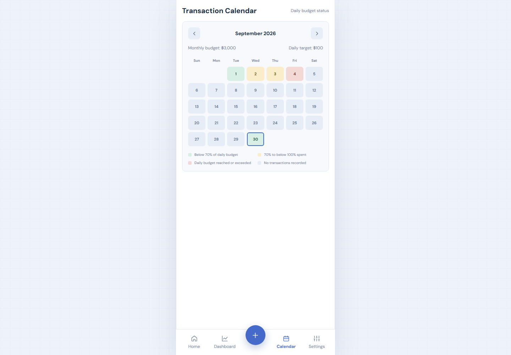

# NubNgern

NubNgern is a Thai-first personal finance tracker for recording income and expenses, reviewing spending, and managing recurring transactions. The current interface is a responsive Alpine.js application backed by Supabase Auth and PostgreSQL.

## Screenshots

| Desktop | Mobile | Calendar Heatmap |
| --- | --- | --- |
|  |  |  |

## Highlights

- Email/password authentication and Google OAuth through Supabase Auth; the unsupported LINE option is omitted from the live-demo login screen.
- Income and expense tracking with categories, payment methods, notes, and transaction dates.
- Create, edit, and delete transactions; swipe-to-delete remains available on touch screens.
- Weekly/monthly dashboard summaries and category chart.
- Monthly expense budgets with a daily Calendar Heatmap and date selection.
- Installable Progressive Web App for Android and iPhone Home Screen.
- Recurring transaction schedules, including editing and activation controls.
- Profile display name, language, and theme preferences stored in `profiles`.
- Export transactions to XLSX through the Express API.
- Row Level Security policies scope Supabase client access to the signed-in user.

## Requirements

- Node.js 18 or newer and npm.
- A Supabase project with the SQL schema applied.
- Google OAuth enabled in Supabase Auth, with provider callback URLs configured in the Google console.

## Installation

1. In the SQL Editor for the project referenced by the frontend, review and run [`database.sql`](database.sql). The script creates missing tables and indexes without dropping existing financial tables. It also adds missing profile columns to existing tables, notifies PostgREST to reload its schema cache, creates owner-scoped RLS policies, and installs a profile trigger.
2. From the repository root, install backend dependencies and create a local environment file:

   ```powershell
   cd backend
   npm ci
   Copy-Item .env.example .env
   ```

3. Set `SUPABASE_URL`, `SUPABASE_SERVICE_ROLE_KEY`, and `SUPABASE_BUCKET` in `backend/.env`. Keep the service-role key server-only; never put it in frontend code or commit `.env`. The browser uses the public anon key in `frontend/app.js`, which must remain protected by correct RLS policies.
4. Start the app:

   ```powershell
   npm start
   ```

5. Open `http://localhost:4000` (or the port configured by `PORT`). The Express server serves the frontend and API from the same origin.

### OAuth setup

Set the Supabase Auth Site URL to the deployed application origin and add each local/deployed origin to the allowed redirect URLs. In the Google provider console, use the callback URL shown by Supabase Auth for the project. The frontend redirects back to the directory serving the app and rejects `file://` launches. LINE is omitted because Supabase returned `Unsupported provider: line`; a custom LINE-to-Supabase identity integration is not included in this demo. OAuth success depends on the live dashboard settings and provider credentials; automated tests do not contact OAuth providers.

## Data access and security

The browser uses Supabase Auth and the public anon key for normal profile, transaction, and subscription CRUD. PostgreSQL RLS policies restrict rows to `auth.uid()`. This avoids an extra Express hop for routine reads/writes and keeps the main UI from requiring service-role permissions.

Express remains responsible for server-side capabilities such as XLSX export, image upload, recurring schedule processing, and routes that use the service-role key. Those routes validate the bearer token and scope user data by the authenticated user ID. Never expose the service-role key to the browser. Rotate it in Supabase if it has been committed, shared, or exposed.

## API

Except for `GET /health`, API routes require `Authorization: Bearer <Supabase access token>`.

| Method | Path | Purpose |
| --- | --- | --- |
| `GET` | `/health` | Backend health check |
| `GET` | `/api/transactions?range=weekly\|monthly\|all&type=income\|expense\|all` | List the signed-in user's transactions |
| `POST` | `/api/transactions` | Create a transaction |
| `DELETE` | `/api/transactions/:id` | Delete an owned transaction |
| `GET` | `/api/dashboard/summary?range=weekly\|monthly\|all` | Aggregate income, expense, net, and category totals |
| `GET` | `/api/subscriptions` | List recurring schedules |
| `POST` | `/api/subscriptions` | Create a recurring schedule |
| `PATCH` | `/api/subscriptions/:id/toggle` | Toggle a schedule |
| `DELETE` | `/api/subscriptions/:id` | Delete a schedule |
| `POST` | `/api/upload` | Upload a JPEG, PNG, or WEBP image (maximum 3 MB) |
| `GET` | `/api/export/xlsx?range=weekly\|monthly\|all&type=income\|expense\|all` | Download an XLSX export |

The browser's normal CRUD currently uses Supabase directly under RLS; the Express transaction routes remain available to other clients. The Express API does not currently expose transaction update or profile endpoints.

### Transaction request example

```json
{
  "type": "expense",
  "category": "food",
  "amount": 125.5,
  "payment_method": "cash",
  "is_subscription": false,
  "note": "Lunch",
  "occurred_at": "2026-09-30T12:00:00.000Z"
}
```

Valid transaction types are `income` and `expense`; payment methods are `cash`, `bank`, and `credit`. Amounts must be positive and limited to two decimal places.

## End-to-end tests

The Playwright suite uses an in-memory Supabase mock and a local static server. It does not require Supabase credentials and does not modify real user data. It verifies transaction create/edit/delete, profile and budget persistence, heatmap thresholds/date selection, mobile date swipes, OAuth fallback behavior, and responsive rendering; it also regenerates the screenshots above.

```powershell
cd backend
npx playwright install chromium
npm run test:e2e
```

## Public Live Demo and Phone Install

The public web URL can allow visitors to create accounts, while Supabase RLS keeps each person's profile, transactions, and subscriptions scoped to their own user ID. Public hosting does not make those rows publicly readable. Apply `database.sql` to the same Supabase project configured in `frontend/app.js` before inviting users.

### Deploy the Express app

1. Push this repository to a private or public GitHub repository.
2. In Render, create a **Web Service** from that repository and leave the root directory at the repository root so the sibling `frontend` folder is included. Set the build command to `cd backend && npm ci` and the start command to `cd backend && npm start`. Render supplies `PORT`; do not hardcode it for production.
3. Add these environment variables in the Render service settings: `SUPABASE_URL`, `SUPABASE_SERVICE_ROLE_KEY`, and `SUPABASE_BUCKET`. Set `CORS_ORIGIN` to the deployed origin if browser clients will call the API from another origin. Keep the service-role key only in the host's secret environment settings.
4. Deploy and copy the HTTPS service URL, such as `https://nubngern-demo.onrender.com`.
5. In Supabase Auth URL Configuration, set the Site URL to that origin and add `https://nubngern-demo.onrender.com/` to the allowed redirect URLs. The Google OAuth callback configured in Google's console remains the Supabase callback URL shown in the Supabase provider settings, not the Render URL.
6. For a public demo, enable the Supabase sign-up methods you want to offer. Keep RLS enabled and verify the owner policies from `database.sql`; do not disable RLS to make the demo work.

Render's free web services can sleep while idle. The first visit may be slow, and the in-process recurring-subscription scheduler only runs while the service is awake. Use an always-on plan or a separately scheduled worker for dependable recurring transaction processing.

### Install on a phone

The site must be served over HTTPS for installation outside localhost. Open the deployed URL in Chrome on Android and choose **Install app** from the browser menu, or use the Install App button in Settings when the browser exposes it. On iPhone, open the HTTPS URL in Safari, tap **Share**, then **Add to Home Screen**. The installed PWA launches without browser chrome and uses the phone viewport.

The service worker caches only the application shell. Sign-in and financial data still require an internet connection; no transaction data is stored for offline use. A PWA installs from the web and does not require App Store or Play Store review.

### Make the demo private later

After the owner has created and verified an account, disable new user sign-ups in Supabase Auth settings. Existing users can continue to sign in; new visitors will not be able to create accounts. Re-enable sign-up methods to make the demo open to the public again. For stricter private access, place an access gate at the hosting layer as well; hiding a frontend button alone is not an access control.

## Current scope notes

- Calendar colors compare daily expenses against the per-day share of the user's monthly budget; the budget is configured in Settings.
- Savings-goal schema exists, but a savings-goal UI/workflow is not currently implemented.
- OAuth provider connectivity must be verified against the live Supabase and provider-console configuration.